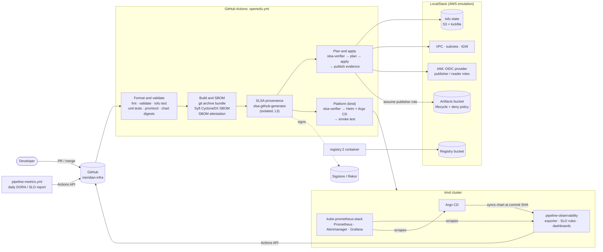

# meridian-infra

**Infrastructure as code with supply chain security, artifact governance and delivery observability, runnable end to end on a laptop.**

OpenTofu, LocalStack, GitHub Actions, kind, kube-prometheus-stack, Grafana and Argo CD. The setup provisions an
AWS-style environment, ships it through a pipeline that produces SLSA Build Level 3 provenance and an SBOM, and
measures that pipeline with SLOs and the four DORA metrics.

---

## 1. Project Summary

`meridian-infra` started as a small OpenTofu configuration (VPC, subnets, an S3 bucket, a container registry)
running against LocalStack. This iteration adds what an infrastructure repository needs before a team can trust it:

- **Supply chain security at SLSA Build L3.** Each change becomes a source bundle with a CycloneDX SBOM and signed,
  unforgeable provenance. Deploy jobs verify that provenance and apply only the verified bundle; they never touch a checkout.
- **Artifact governance.** The bucket holding releases, SBOMs, attestations and plans has a lifecycle per artifact class,
  a deny-only bucket policy, and a publisher role that only the `main` branch can assume.
- **Delivery observability.** A GitHub Actions exporter feeds Prometheus with pipeline SLIs and DORA metrics.
  Burn-rate alerts and two Grafana dashboards run on a kind cluster managed through Argo CD.
- **Everything runs locally.** One PowerShell script brings up LocalStack, the kind platform, the test suite, SBOM generation
  and a DORA report on Windows with only Docker, OpenTofu and kind. CI runs the same checks.

| | |
|---|---|
| Scope | 39 files changed, about 4,900 lines added |
| Infrastructure modules | 2 OpenTofu root modules (LocalStack AWS, kind platform) sharing one S3 state backend |
| Delivery | 5-job CI pipeline + 1 scheduled metrics workflow |

## 2. Problem Statement

The original repository applied whatever was on `main`, straight from a checkout, with unpinned dependencies. That
leaves three gaps common in infrastructure teams:

1. **No chain of custody.** Nothing proved that what was applied was what had been reviewed. Providers, actions and
   images could change under the same tag, and there was no inventory of what the deployment depended on.
2. **Unmanaged artifacts.** Build outputs, plans and evidence had no retention policy. Nothing stopped them from being
   overwritten or deleted, and nothing kept short-lived sensitive data (plans) apart from long-lived evidence (provenance).
3. **No feedback on delivery.** Nobody could say whether the pipeline was reliable, how long changes took to ship, or
   how often deployments broke, so the pipeline couldn't be held to an objective or improved on evidence.

The constraint: all of it had to be testable locally and in ephemeral CI runners, with no cloud account, using
LocalStack's free tier (no ECR, no IAM enforcement).

## 3. Technologies Used

| Area | Technology |
|---|---|
| Infrastructure as code | OpenTofu 1.13 (`hashicorp/aws`, `helm`, `kubernetes`, `random`, `kreuzwerker/docker`), `tofu test` with mock providers |
| Cloud emulation | LocalStack (S3, EC2, IAM, STS), self-hosted Docker registry backed by S3 |
| CI/CD | GitHub Actions, reusable workflows, OIDC, artifact attestations, Dependabot |
| Supply chain | SLSA (`slsa-github-generator`, `slsa-verifier`), Sigstore keyless signing, Syft, CycloneDX, `actions/attest` |
| Kubernetes | kind v0.33 (Kubernetes 1.37), Helm |
| Observability | kube-prometheus-stack (Prometheus Operator, Prometheus, Alertmanager, Grafana), PromQL recording and alerting rules, `promtool` |
| GitOps | Argo CD, `argocd-apps` |
| Tooling | Python 3.12 (standard library only), PowerShell 5.1, Bash, actionlint |

### Architecture overview



**Flow:** CI validates the change, packages it, describes it (SBOM) and signs where it came from (provenance).
Deploy jobs refuse anything they can't verify, then apply to LocalStack and publish the evidence to a governed
bucket. In the cluster, the exporter reads the pipeline's own history back from GitHub, turning delivery into SLIs,
error budgets and DORA metrics on Grafana.

## 4. Key Design Decisions

**Deploy the artifact, not the checkout.** Build produces one `git archive` bundle. `plan-apply` and `platform` have
no `actions/checkout` step: they download the bundle, check it against the build job's hashes, verify its SLSA
provenance against the source repo and branch, and only then unpack and run it. This is what turns provenance from a
badge into a control.

**Isolated provenance for Level 3.** Provenance comes from the `slsa-github-generator` reusable workflow, so build
steps never hold the signing identity. GitHub's attestation is added separately, for the SBOM only, so consumers can
check either with `slsa-verifier` or `gh attestation verify`.

**Pin everything, verify twice.**
- Actions are pinned to commit SHAs; Dependabot updates them with a 7-day cooldown.
- Providers pass through an allow-list (`tofu.tfrc`) and lockfiles hashed for 5 platforms, with `-lockfile=readonly` in CI.
- Container images are pinned by digest.
- Helm charts are pinned by SHA-256 in one lockfile. OpenTofu reads versions from it, and CI re-downloads every chart to check its digest.

**Deny-only bucket policy, grants in IAM.** Every bucket-policy statement is a `Deny`: no TLS, wrong encryption
header, writer other than the publisher role, deletion of evidence. Access is granted only by IAM roles, so the
policy reads as a list of invariants. The publisher role trusts GitHub OIDC only for `refs/heads/main`.

**Retention by artifact class.** Provenance (730 days) outlives the releases it describes (400 days), so any release
can be verified for its whole life. Plans, which can hold sensitive values, expire after 30 days. A validation rule
rejects any configuration that breaks that ordering.

**SLOs sized for low-volume events.** Pipelines run a few times a day, not thousands of times an hour, so the classic
5m/1h burn-rate windows would be pure noise. The exporter reports SLIs over 1d, 7d and 28d windows. The alerts pair
1d with 7d (fast burn) and 7d with 28d (slow burn), and they ignore cancelled and PR runs, because a failing PR
is the pipeline doing its job.

**DORA lead time per commit, not per merge.** The merge commit's timestamp would measure only pipeline time. The
exporter uses the GitHub compare API to find every commit each deployment shipped, measures from each commit's author
time, and caches the results by immutable SHA pair to stay within API limits.

**Small dependency surface for the exporter.** The exporter is one stdlib-only Python file, mounted from a ConfigMap
into a digest-pinned Python image. It needs no image build or third-party packages, and runs as non-root with a
read-only root filesystem and every capability dropped. The same file produces the CI report (`--once --format markdown`).

**GitOps in CI, fast inner loop locally.** Argo CD syncs the chart from GitHub at the exact commit under test. Locally,
`platform-up` sees when `charts/` has unpushed changes and installs the working tree with Helm instead, so chart
changes can be tested before they're pushed.

## 5. Challenges and How They Were Solved

| Challenge | Solution |
|---|---|
| **Argo CD can only deploy what's on GitHub**, so chart changes couldn't be tested locally before a push. | Added `pipeline_observability_source` (`argocd` or `helm`). The local script compares `charts/` with the upstream branch and switches to Helm automatically, with a warning. The smoke test adapts to either mode. |
| **Helm validates every manifest before install**, so an Argo CD `Application` can't ship in the same release as its CRD. | Split it into a separate `argocd-apps` release that depends on the Argo CD release. ServiceMonitors and PrometheusRules wait on kube-prometheus-stack the same way. |
| **`promtool` rejected the SLO rules as duplicates.** Same-name recording rules that differed only through `label_replace` count as identical. | Moved the distinguishing `slo` label into static rule `labels`. Then added `promtool test rules` unit tests that assert fast burn fires at 15m but not at 5m, slow burn and SLO violation fire on an overspent budget, and quiet conditions stay quiet. |
| **Helm template math silently truncated.** Sprig's `sub` is integer-only, so `1 - 0.95` rendered as `0`, and the burn-rate denominators would have been zero. | Switched to `subf`, and checked the rendered rules (`/ 0.05`, `/ 0.1`) before shipping. |
| **LocalStack can't validate GitHub OIDC tokens**, but the publisher role should still be exercised. | The role trusts GitHub OIDC (for real AWS) and the same account. CI assumes it through STS, and the bucket policy accepts writes from that role only. A local rehearsal confirmed uploads run as `assumed-role/…-artifact-publisher`. |
| **kind binds the control plane to localhost**, so default kube-prometheus-stack scraping produced permanently firing etcd, scheduler and controller-manager alerts. | Disabled those scrape targets and their default rules for the kind profile. |
| **Windows PowerShell 5.1 turns native stderr into terminating errors**, which broke calls whose stderr is expected (`kind get clusters`, `git rev-parse @{u}`). | Added an `Invoke-Quiet` helper that relaxes the error action for those calls and returns output and exit code. Tools that are awkward on Windows (Syft, Helm, promtool, Linux Python) run from digest-pinned containers. |
| **State drift from earlier sessions.** An orphaned registry container blocked apply after LocalStack restarted empty, and port 8080 was taken by another local cluster. | Imported the orphan into state, so OpenTofu (its owner) reconciled it instead of it being deleted by hand. Moved Argo CD to port 8088. |
| **An exporter parsing bug** turned `.github/workflows/opentofu.yml@refs/heads/main` into the workflow name `main`. | A unit test caught it, and the fix strips the ref before taking the basename. |
| **`actions/attest-sbom` is deprecated.** | Used its successor `actions/attest` with `sbom-path`, pinned by SHA. |

## 6. Outcomes and Metrics

Measured locally during development:

| Check | Result |
|---|---|
| OpenTofu unit tests (`tofu test`, mock providers) | **5/5 pass**: lifecycle coverage, policy guards, TLS toggle, OIDC trust scoped to `main`, retention-ordering validation |
| Exporter unit tests | **17/17 pass**: SLI windows, DORA frequency and change failure rate, lead time across commits, time to restore, open incidents, exposition format |
| Prometheus rules | **11 rules** pass `promtool check rules`, and all `promtool test rules` cases pass |
| Workflow lint | actionlint (with shellcheck) clean on both workflows |
| LocalStack apply | Second plan shows **no changes** (idempotent). The live bucket has **7 lifecycle rules** and **4 policy statements** |
| Artifact governance | Upload as the publisher role succeeded. LocalStack evaluated the expiry of an attestation object at 730 days under `attestations-tiering`, AES256-encrypted |
| SBOM | **844 components** at 1.4 MB: 813 Go modules from the provider binaries, 5 OpenTofu providers, 3 digest-verified Helm charts, 9 GitHub Actions |
| Pinning | 100% of third-party actions SHA-pinned (except the SLSA generator, which must be pinned by tag), every image digest-pinned, provider lockfiles cover 5 platforms |
| Platform on kind | Smoke test **9/9**: workloads available, exporter and Argo CD scraped, SLO rules loaded, live GitHub data flowing, both dashboards provisioned. Second plan shows no changes. About **2.5 GiB** memory |

First GitHub Actions run, on the pull request ([run 40798977217](https://github.com/umamidayo/meridian-infra/actions/runs/40798977217)):

| Job | Result | Duration |
|---|---|---|
| Format and validate | success | 38 s |
| Build and SBOM | success | 24 s |
| Plan | success (bundle integrity verified, LocalStack plan) | 1 m 03 s |
| Platform (kind) | success (Argo CD synced the PR commit from GitHub, smoke test passed) | 4 m 16 s |
| SLSA provenance | skipped by design on PRs; runs on merge to `main` | |
| **Whole pipeline** | **all required checks green** | **5 m 27 s** |

Provenance generation, `slsa-verifier` gating, apply and evidence publishing run on the first merge to `main`.

What it enables:

- **Auditability:** any applied change can be traced to a commit, workflow run and builder identity, with an inventory of every dependency.
- **Safer deploys:** a bundle that's been tampered with, or built from another branch or repository, fails verification before `plan`.
- **Delivery evidence:** deployment frequency, lead time, change failure rate and time to restore, rated against DORA's elite/high/medium/low bands, plus error budgets that say when to stop shipping features and fix the pipeline.

---

## Running it

**Prerequisites:** Docker, OpenTofu >= 1.10, a LocalStack auth token (free tier; `lstk login`). For the platform you also need kind v0.33, kubectl and Python 3.

### Windows

```powershell
.\scripts\local.ps1 up              # LocalStack + state bucket + apply
.\scripts\local.ps1 test            # same checks as CI's validate job
.\scripts\local.ps1 sbom            # CycloneDX SBOM -> meridian-infra.cdx.json
.\scripts\local.ps1 metrics         # DORA / pipeline SLO report from the GitHub API
.\scripts\local.ps1 platform-up     # kind + kube-prometheus-stack + Argo CD + dashboards
.\scripts\local.ps1 platform-test   # end-to-end smoke test
.\scripts\local.ps1 platform-down   # destroy and delete the cluster
.\scripts\local.ps1 down            # destroy, then stop LocalStack
```

Add `powershell -ExecutionPolicy Bypass -File` in front if your policy blocks local scripts. Set
`$env:TF_VAR_github_token` to raise the exporter's GitHub API limit above 60 requests/hour.

| UI | URL | Login |
|---|---|---|
| Grafana (Meridian folder) | http://localhost:3000 | `admin` / `tofu -chdir=platform output -raw grafana_admin_password` |
| Prometheus | http://localhost:9090 | |
| Argo CD | http://localhost:8088 | `admin` / `argocd-initial-admin-secret` |

### Linux/macOS

```bash
export LOCALSTACK_AUTH_TOKEN=... TF_CLI_CONFIG_FILE=$PWD/tofu.tfrc
docker compose up -d && bash scripts/bootstrap-state.sh
tofu init && tofu apply

kind create cluster --config platform/kind-cluster.yaml
tofu -chdir=platform init
tofu -chdir=platform apply -var pipeline_observability_source=helm
python3 scripts/smoke_platform.py
```

### CI setup

1. Add the repository secret `LOCALSTACK_AUTH_TOKEN` (a CI auth token).
2. Protect `main`: require a reviewed PR, block force pushes, and require `Format and validate`, `Build and SBOM`, `Plan`
   and `Platform (kind)`. That's the source half of SLSA, and only `main` can publish artifacts.

LocalStack in CI is ephemeral: each run starts empty, and the published evidence lives only for that job.
Provenance and SBOMs remain downloadable as workflow artifacts, and the SBOM attestation stays on GitHub.

## Repository layout

```
*.tf                         LocalStack root module (network, registry, storage, IAM)
tests/                       tofu tests, exporter unit tests, promtool rule tests
platform/                    kind root module, chart lockfile, kind cluster config
charts/pipeline-observability/  exporter, SLO rules, Grafana dashboards
scripts/                     local.ps1, CI LocalStack bootstrap, chart verification, SBOM summary, smoke test
.github/workflows/           opentofu.yml (build → attest → verify → deploy), pipeline-metrics.yml
docs/                        supply-chain.md, observability.md
```

Further reading: [docs/supply-chain.md](docs/supply-chain.md) (SLSA mapping, verification commands, known gaps) and
[docs/observability.md](docs/observability.md) (SLI definitions, alerts, DORA methodology).
